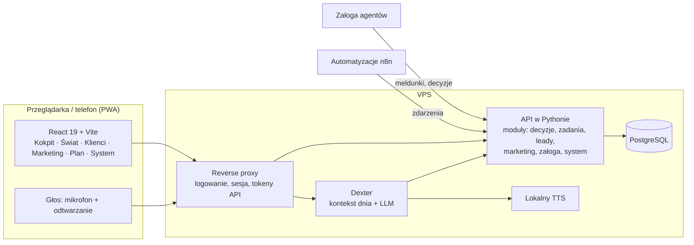
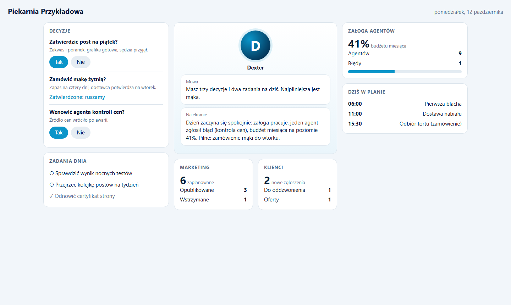
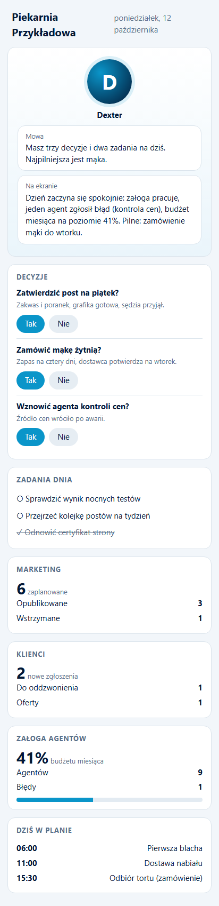

# D.E.X.T.E.R. Command Center

Panel dowodzenia małą firmą AI z asystentem Dexterem w centrum. Jeden ekran: decyzje do podjęcia, zadania dnia, praca agentów, marketing, klienci.

*Command center for a small AI business, with the Dexter assistant at its core.*

> Wizytówka projektu. Kod produkcyjny jest prywatny. / Showcase repository. Production code is private.

---

## PL

### Problem
Firma jednoosobowa z kilkudziesięcioma automatyzacjami traci kontrolę: powiadomienia rozsiane po Telegramie, mailu i logach, decyzje giną, a nikt nie widzi, czy coś przestało działać.

### Rozwiązanie
Jeden panel, do którego wszystko zgłasza się przez API:
- **Kokpit** w układzie U: decyzje i zadania po lewej, Dexter w środku, kafle dnia, terminali, marketingu i klientów dookoła.
- **Dexter**: asystent tekstowy i głosowy, który zna stan firmy (plan, alarmy agentów, kalendarz) i odpowiada w dwóch warstwach: krótka mowa plus treść do przeczytania na ekranie.
- **Decyzje zamiast powiadomień**: każdy agent i każda automatyzacja zakłada decyzję w panelu; człowiek klika „tak” albo „nie”, a dopiero wtedy coś rusza.
- **Świat**: mapa firmy jako dolina z budynkami działów; agenci mieszkają w budynkach, a ich przebiegi widać na żywo.
- **Mapa infrastruktury** generowana skanerem, z audytem rozjazdu między tym, co narysowane, a tym, co wykryte.
- Aplikacja na telefon (PWA), a w budowie cienki klient na Androida: telefon słucha i mówi, mózg zostaje na serwerze.

### Architektura



### Decyzje projektowe
- **Tokeny nigdy w przeglądarce.** Proxy dokleja nagłówki z tokenami po stronie serwera; paczka frontendu przechodzi strażnika, który odrzuca build zawierający cokolwiek, co wygląda jak klucz.
- **Logowanie PIN-em** ze skrótem PBKDF2, sesją HMAC w ciasteczku HttpOnly i blokadą prób na adres i globalnie.
- **Mowa i ekran rozdzielone.** Model oddaje znacznik, który dzieli krótką odpowiedź głosową od treści do czytania; nadmiar mowy tnie kod, nie prompt.
- **Mapa z trzech plików**: rysunek ręczny, twierdzenia człowieka i plik generowany przez skaner. Generowanego nie edytuje się ręcznie; test pilnuje rozjazdu.
- **Telefon pierwszy.** Układ U na komputerze rozkłada się na telefonie w jedną kolumnę bez przepisywania komponentów (`display: contents` i kolejność).

### Stack
React 19, Vite 6, Vitest, Python (API i moduły serwera), PostgreSQL, Caddy, ElevenLabs (głos), lokalny TTS na CPU, OpenRouter, Kotlin (klient Android w budowie).

### Efekt
Panel działa produkcyjnie jako jedyne miejsce decyzji w firmie. Repozytorium ma ponad 450 commitów, ponad 50 plików testów frontendu i ponad 60 modułów serwera (Python i SQL).

---

## EN

**Problem.** A one-person company with dozens of automations loses control: alerts scattered across Telegram, email and logs, decisions get lost, nobody notices when something stops.

**Solution.** One dashboard everything reports to. A U-shaped cockpit (decisions and tasks, Dexter in the center, tiles for the day, terminals, marketing, clients). Dexter is a text and voice assistant that knows the state of the company and answers in two layers: short speech plus on-screen detail. Every agent and automation opens a *decision* instead of sending a notification; nothing runs until a human clicks. A "World" view shows the company as a valley of department buildings with live agent activity. Infrastructure map generated by a scanner, with drift audit. PWA today, a thin Android client in progress (the phone listens and speaks, the brain stays on the server).

**Design decisions.** Tokens never reach the browser (server-side proxy injects them; the build is rejected if anything key-like slips in). PIN login with PBKDF2, HMAC session cookie, rate limiting. Speech and screen split by a marker, excess speech trimmed in code. Mobile first without duplicating components.

**Stack.** React 19, Vite 6, Vitest, Python, PostgreSQL, Caddy, ElevenLabs, local CPU TTS, OpenRouter, Kotlin.

**Result.** In production as the single decision point of the company. 450+ commits, 50+ frontend test files, 60+ server modules.

## Jak uruchomić / Run it

Przykład w repozytorium to działające demo trzech decyzji projektowych na danych wymyślonych (Piekarnia Przykładowa): logowanie PIN-em (PBKDF2, sesja HMAC, blokada prób), proxy, które dokleja token po stronie serwera, podział mowy i ekranu w kodzie, strażnik paczki frontendu oraz Kokpit w układzie U. Produkcyjny panel, Świat, Dexter głosowy i klient Android są prywatne.
*A working demo of three design decisions on invented data: PIN login (PBKDF2, HMAC session, rate limit), a proxy that adds the token server-side, speech/screen split in code, a frontend build guard, and the U-shaped cockpit. The production dashboard, World view, voice Dexter and Android client are private.*

```bash
pip install -r requirements.txt
python -m pytest -q                    # 17 testów (logowanie, mowa, strażnik, serwer)
python demo/build_demo.py              # buduje demo/kokpit.html i zrzuty (playwright install chromium)
python -m server.app                   # panel z logowaniem: http://127.0.0.1:8765, PIN demo 2468 (zmienna KOKPIT_PIN)
python -m server.buildguard demo       # strażnik paczki: kod wyjścia 1, gdy coś wygląda jak klucz
```

Gotowy plik bez serwera: `demo/kokpit.html` (przyciski Tak i Nie działają). Struktura: `server/auth.py`, `server/speech.py`, `server/buildguard.py`, `server/app.py`, `demo/`, `tests/`.

### Demo: Kokpit na komputerze i na telefonie

Decyzje i zadania po lewej, Dexter w środku (mowa osobno, treść osobno), kafle dookoła. Na telefonie ten sam układ rozkłada się w jedną kolumnę bez przepisywania komponentów.
*Decisions and tasks on the left, Dexter in the middle (speech and screen text separate), tiles around. On a phone the same layout collapses to one column.*





---

<p align="center"><br>
Zbudowane w <a href="https://cyfrownia.com">Cyfrowni</a>, agencji AI z Grudziądza. Kontakt: <a href="mailto:biuro@cyfrownia.com">biuro@cyfrownia.com</a></p>
